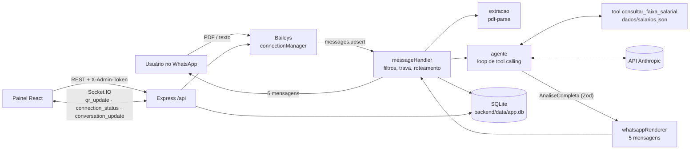

# Quanto Tô Valendo · WhatsApp Edition

Agente de análise salarial para profissionais de dados, rodando nativo no WhatsApp.

A pessoa manda o currículo (PDF ou texto) para um número de WhatsApp e recebe, em sequência, a resposta para **"quanto tô valendo — e como passo a valer mais?"**, com base na pesquisa *State of Data Brazil 2025-2026* (Data Hackers / Bain & Company).

O produto é **inbound**: responde quem manda mensagem e nunca dispara em massa. O painel React serve só para administração (conexões, histórico, toggles, prompt e modelo); o usuário final fica no WhatsApp.

A especificação completa está em [`.llm/prd.md`](.llm/prd.md).

## A narrativa: 3 atos + "one more thing"

Cada ato chega como uma mensagem separada, com 1,5–2,5s de intervalo e "digitando..." entre elas:

| # | Mensagem | O que diz |
|---|---|---|
| 1 | **O Veredito** | Cargo e senioridade estimados, a faixa típica ("a maioria ganha entre X e Y", "o valor típico") e a justificativa com evidências do CV. |
| 2 | **O Delta** | Quanto paga o próximo nível e **quantos R$ por mês** separam a pessoa dele. Para staff, vira reconhecimento ("você está no topo da tabela"). |
| 3 | **O Caminho** | Até 3 lacunas concretas em relação ao próximo nível. |
| 4 | **Plano de 90 dias** | Roadmap por fase que ataca essas lacunas. |
| 5 | **Mais uma coisa…** | Resumo profissional reescrito, pronto para colar no LinkedIn. |

Os números salariais vêm **só** da tool `consultarFaixaSalarial`, que lê `dados/salarios.json`. Depois da validação Zod, o agente ainda recalcula as faixas e o delta com a tool, para que nenhum número venha do texto do modelo.

## Arquitetura



| Camada | Stack | Porta |
|---|---|---|
| Backend | Node.js 20+, Express, Socket.IO | 3001 |
| WhatsApp | `@whiskeysockets/baileys` (multi-conexão, sessão em `backend/sessions/`) | — |
| Agente | `@anthropic-ai/sdk` + Zod | — |
| Banco | SQLite (`better-sqlite3`) | — |
| Painel | React + Vite | 5173 |

Camadas do backend (`backend/src/`), com a regra de dependência verificada por `test/dependencia.test.js`:

- `core/`: agente, tool, schema, prompts, extração de PDF e erros de domínio. Não importa nenhuma outra camada.
- `renderers/`: `AnaliseCompleta` → 5 mensagens. Importa só `core/schema.js`.
- `managers/`: Baileys (`connectionManager`) e o fluxo de cada mensagem (`messageHandler`).
- `db/`, `routes/`, `server.js`: persistência, API REST e boot.

## Design system do painel

Dashboard *dark industrial*: verde WhatsApp `#25D366` sobre `#0d1117` / `#161b22`, JetBrains Mono para dados técnicos, Inter para títulos, bordas sutis e sem sombras. Sidebar fixa; o header mostra o nome e o número de conexões ativas.

## Setup local

Pré-requisito: Node 20+.

```bash
# backend
cd backend
cp .env.example .env        # preencha ANTHROPIC_API_KEY e ADMIN_TOKEN
npm install
cd ..

# painel
cd frontend
cp .env.example .env        # VITE_API_URL / VITE_SOCKET_URL = http://localhost:3001
npm install
cd ..
```

### Como rodar

```bash
npm run backend             # http://localhost:3001  (GET /health)
npm run frontend            # http://localhost:5173
npm test                    # suíte Vitest do backend (sem rede, sem API)
cd backend && npm run exemplo   # análise real com um CV fictício (gasta API)
```

As variáveis `VITE_*` entram no bundle em **build-time**: refaça `npm run build` no `frontend/` sempre que o endereço do backend mudar.

## Conectando o primeiro número

1. Abra o painel, entre com o `ADMIN_TOKEN` e vá em **Conexões → Nova conexão**.
2. Clique em **Conectar**. No celular: WhatsApp › **Aparelhos conectados** › Conectar um aparelho, e escaneie o QR.
3. Quando o status virar **Conectado**, mande um PDF de currículo para esse número.

Use um **número dedicado**. O Baileys é uma biblioteca não oficial e existe risco de bloqueio, mesmo num produto inbound.

Deploy numa VPS: veja [`DEPLOY.md`](DEPLOY.md).
